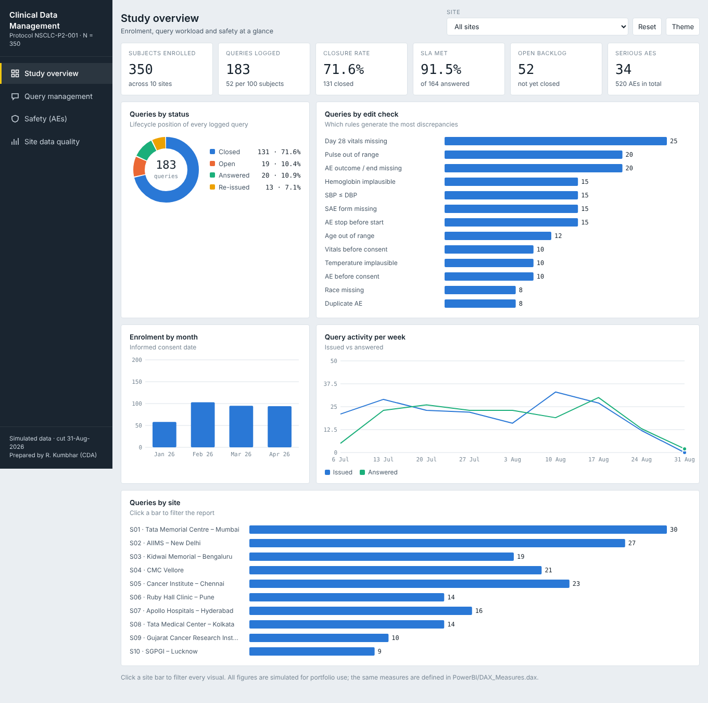
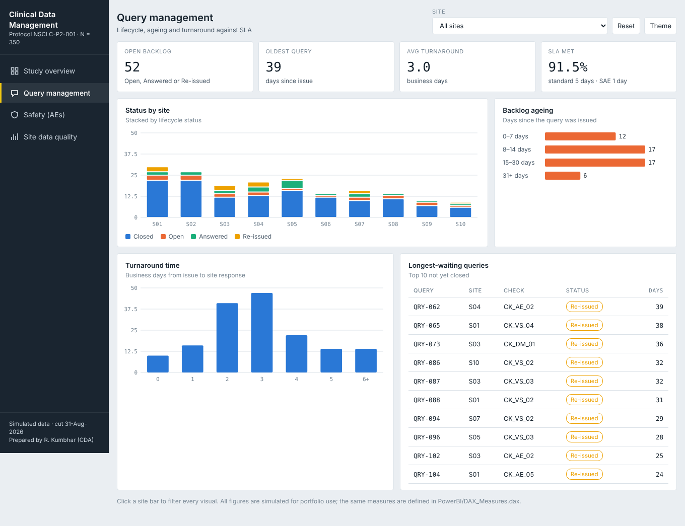
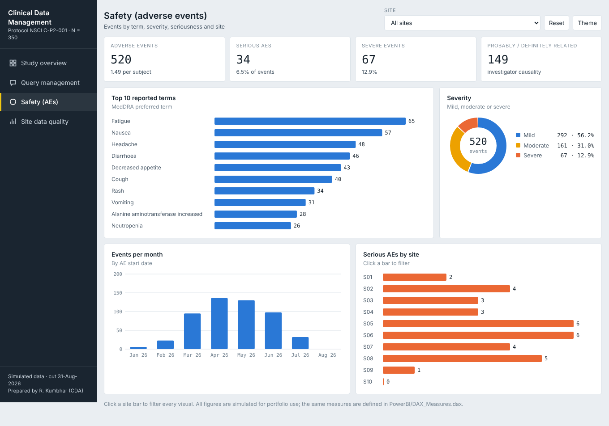
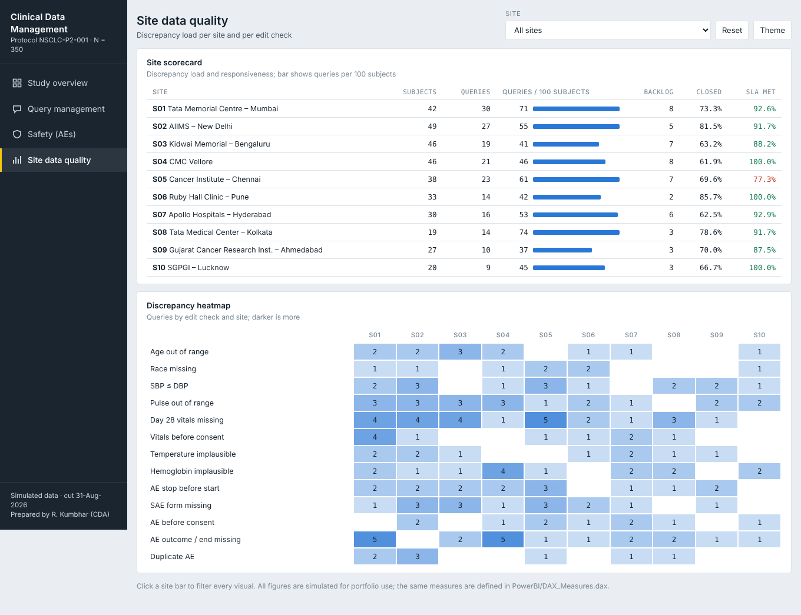

# Clinical Data Management Portfolio

**End-to-end clinical data management simulation for a Phase II oncology study (Protocol NSCLC-P2-001, N = 350)**

> **Note:** This is a self-initiated learning project. All data, site names and the protocol are fictional and were simulated for practice. No real patient data is used.

**Author:** Rushikesh Kumbhar  |  **Focus:** Clinical Data Associate / Clinical Data Management

**Live dashboard:** `https://<your-github-username>.github.io/clinical-data-management-portfolio/` (enable GitHub Pages, see the bottom of this file)



---

## What this project demonstrates

| Skill | Evidence in this repo |
|---|---|
| Data Management Plan | 4-page DMP with roles, SDV criteria, query SLAs and lock procedure |
| eCRF design | DM, VS, AE and LB form specs with controlled terminology and linked edit checks |
| Edit check specification | 13 checks (boundary, cross-form, sequence, missing data, duplicates) with GCP-style query text |
| Data cleaning (DVP execution) | Python script that runs every check and finds all 183 seeded discrepancies |
| Query management | 183-query tracker: lifecycle, turnaround, SLA, ageing, closure initials, audit timestamps |
| CDISC SDTM | Mapping specification for DM, VS, AE and LB |
| Reporting | Power BI data model, DAX measures, Power Query and a four-page dashboard |

## Repository contents

| File / folder | Description |
|---|---|
| `Data_Management_Plan_DMP.docx` | Data Management Plan |
| `Study_Visit_Matrix_and_eCRF_Specifications.xlsx` | Visit schedule, form-by-visit matrix, eCRF specs |
| `Data_Validation_Plan_and_Edit_Checks.xlsx` | Edit check specs, discrepancy listing, validation summary |
| `Master_Discrepancy_and_Query_Tracker.xlsx` | 183 queries with live summary formulas |
| `CDISC_SDTM_Mapping_Specification.xlsx` | Raw-to-SDTM mapping (DM, VS, AE, LB) |
| `Simulated_Clinical_Trial_Dataset/` | DM, VS, LB, AE, Sites CSVs |
| `PowerBI/` | Star schema CSVs, DAX, Power Query, theme, setup guide |
| `docs/index.html` | Interactive dashboard (served by GitHub Pages) |
| `scripts/` | Python and Node scripts that regenerate everything |

## Key numbers

- 350 subjects, 10 sites; 1,400 vital sign records, 700 lab records, 520 adverse events
- 183 seeded discrepancies across 13 edit checks, all detected (100%)
- 183 queries raised; 71.6% closed, 91.5% of answered queries within SLA, average turnaround 3.0 business days

## Dashboard pages

| | |
|---|---|
|  |  |
|  | |

## The error types I seeded and how each is caught

| Check | What it catches | Count |
|---|---|---|
| CK_VS_03 | Missing Day 28 vital signs | 25 |
| CK_VS_02 | Pulse outside 40–140 bpm | 20 |
| CK_AE_04 | AE with no end date or outcome and not ongoing | 20 |
| CK_VS_01 | Systolic BP ≤ diastolic BP | 15 |
| CK_LB_01 | Impossible hemoglobin (e.g., 220 g/dL) | 15 |
| CK_AE_01 | AE stop date before start date | 15 |
| CK_AE_02 | Serious AE without SAE form | 15 |
| CK_DM_01 | Age outside 18–75 | 12 |
| CK_VS_04, CK_VS_05, CK_AE_03 | Vitals before consent, temperature unit error, AE before consent | 10 each |
| CK_DM_02, CK_AE_05 | Missing race, duplicate AE | 8 each |

## What I learned

- Why queries must be neutral and non-leading under GCP, and how to write them from the data alone.
- How cross-form checks (consent date, SAE form) catch problems a single-field range check cannot.
- How raw eCRF variables map into SDTM and why cleaning has to happen before mapping.
- How to turn query logs into metrics (closure rate, SLA, ageing) that a study team can act on.

## How to reproduce

```bash
pip install pandas numpy openpyxl
python scripts/01_generate_dataset.py
python scripts/02_run_validation.py
python scripts/03_build_excel.py
python scripts/05_build_powerbi_model.py
node scripts/04_build_dmp.js Data_Management_Plan_DMP.docx   # needs: npm install docx
```

## Open the Power BI version

See `PowerBI/README_PowerBI_Workspace.md` for the data model, relationships and build steps.

## Enable the live dashboard (GitHub Pages)

Repository **Settings → Pages → Build and deployment**: Source "Deploy from a branch", Branch `main`, Folder `/docs`, then Save. After about a minute the link appears at the top of that page. Paste it into the **Live dashboard** line above.
